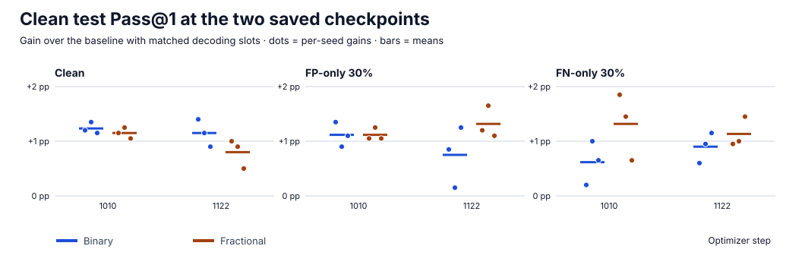
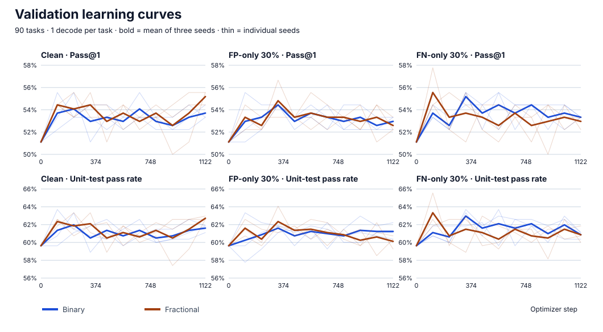
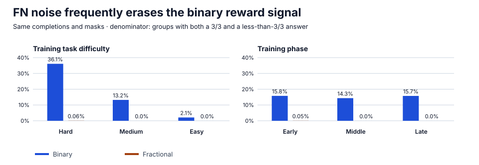

# Offline analysis of GRPO training under verifier errors

Priority Bridge v2 trained Qwen3-1.7B-Base with LoRA for 1,122 steps per run
under six conditions and three training seeds. The analysis covers 17,820
validation predictions, 72,000 test predictions, 4,000 responses from the
shared base model, 323,136 training completions in 20,196 groups, and saved
gradient metrics for 54 groups. It uses the original MBPP splits and frozen
difficulty labels. [Experiment protocol](../../docs/EXPERIMENT_PROTOCOL.md)

Under false negatives, fractional rewards better preserved differences
between responses and gradient direction on the audited groups. The primary
test Pass@1 contrast was small and changed sign across training seeds.
The observed gains over the baseline were about one percentage point.

## 1. Primary contrast in test Pass@1

The pre-registered contrast is `(FN − FP) fractional − (FN − FP) binary`.
A positive value means that FN minus FP is larger under fractional rewards.
Each task contributes four generations at step 1010 and four at step 1122.
Pass@1 estimates the probability that one response passes all tests. The
baseline comparison uses the same tasks and decoding seed slots.
[Pre-registration](../../notes/pre_registration.md)

| Contrast (pp) | Seed 0 | Seed 1 | Seed 2 | Mean | 95% seed-level CI |
|---|---:|---:|---:|---:|---:|
| FN − FP under binary | −0.70 | +0.45 | −0.28 | −0.18 | [−1.62, +1.27] |
| FN − FP under fractional | +0.28 | −0.23 | −0.03 | +0.01 | [−0.62, +0.63] |
| **(FN − FP) fractional − (FN − FP) binary** | **+0.98** | **−0.68** | **+0.25** | **+0.18** | **[−1.87, +2.24]** |

A paired bootstrap across training seeds and tasks gives a 95% interval of
[−0.87, +1.21] percentage points for the primary contrast. The bootstrap used
10,000 replicates and the same resampled tasks across selected seed blocks.
The seed-level estimate uses a Student t interval with two degrees of freedom,
holding tasks and decoding slots fixed. Both intervals span zero. Assessing
whether FP and FN are practically equivalent under fractional reward would
require a pre-specified equivalence margin. The secondary metric, average
fraction of unit tests passed, gives a similar result. Its primary contrast
is +0.15 points with a seed-level t interval of [−1.84, +2.13].

### Gains over the untrained model

At each checkpoint, evaluation used four responses per task on 500 test tasks.
The comparison used four responses from the same untrained model on the same
tasks with matching decoding seed slots. Step 1010 used the first four slots
and step 1122 used the next four. The untrained model therefore has two
Pass@1 estimates, 48.90% and 48.00%. Their mean, 48.45%, is the baseline for
the primary evaluation.

In the table, **Pass@1** is the percentage of responses that passed all tests.
**Gain** is trained Pass@1 minus the baseline for the same decoding slots, in
percentage points (pp). Each condition is averaged across the three training
seeds. The primary Pass@1 gives equal weight to both checkpoints.

| Condition | Pass@1 at 1010 | Gain at 1010 (pp) | Pass@1 at 1122 | Gain at 1122 (pp) | Primary Pass@1 | Primary gain (pp) |
|---|---:|---:|---:|---:|---:|---:|
| Untrained model | 48.90% | — | 48.00% | — | 48.45% | — |
| Clean / binary | 50.13% | +1.23 | 49.15% | +1.15 | 49.64% | +1.19 |
| Clean / fractional | 50.05% | +1.15 | 48.80% | +0.80 | 49.43% | +0.98 |
| FP / binary | 50.02% | +1.12 | 48.75% | +0.75 | 49.38% | +0.93 |
| FP / fractional | 50.02% | +1.12 | 49.32% | +1.32 | 49.67% | +1.22 |
| FN / binary | 49.52% | +0.62 | 48.90% | +0.90 | 49.21% | +0.76 |
| FN / fractional | 50.22% | +1.32 | 49.13% | +1.13 | 49.68% | +1.23 |

For **Clean / binary**, gains are 50.13% − 48.90% = **+1.23 pp** at step 1010
and 49.15% − 48.00% = **+1.15 pp** at step 1122. The primary gain is
49.64% − 48.45% = **+1.19 pp**. Averages and differences use unrounded
values, so recalculating from the displayed numbers can differ by 0.01 pp.

The **primary contrast** compares the four noisy conditions. At step 1010,
FN − FP is **+0.20 pp** under fractional reward (50.22% − 50.02%) and
**−0.50 pp** under binary reward (49.52% − 50.02%). The difference between
them is **+0.70 pp**. The baseline cancels because all conditions at a given
step share it. This contrast is **−0.33 pp** at step 1122 and averages
**+0.18 pp** across the two checkpoints, using unrounded values. The
checkpoints used different decoding slots, so the two estimates cannot
distinguish changes in the model from decoding variability.



## 2. Validation and test difficulty

Validation ran at step 0 and ten training checkpoints. All conditions used
the same 90 tasks and the same assignment of decoding seeds to tasks. At step
0, all models scored 51.11% Pass@1. At step 1122, the three-seed means were
53.70% and 55.19% for clean, 52.96% and 52.59% for FP, and 53.33% and 52.96%
for FN, with binary listed first in each pair. On one seed, a single solved
task changes validation Pass@1 by 1.11 pp. The plots show both the mean and
individual seed trajectories. Frozen difficulty labels are available for the
test tasks.



| Test difficulty | Tasks | Baseline Pass@1 | Range of gains across conditions (pp) | Primary contrast and 95% seed-level CI (pp) |
|---|---:|---:|---:|---:|
| Hard | 220 | 15.28% | +0.25 to +0.97 | +0.19 [−1.37, +1.74] |
| Medium | 130 | 55.48% | +0.38 to +1.70 | −0.35 [−4.39, +3.69] |
| Easy | 150 | 91.00% | +1.17 to +2.03 | +0.64 [−0.97, +2.25] |

For all six conditions, the largest observed gains were on easy tasks. Hard
tasks remained difficult after training. The frozen labels describe difficulty
for the original base model, while gains are measured against the matched v2
baseline. The intervals are wide for all strata, so the estimates leave open
whether aggregation affects Pass@1 differently by difficulty. Two test
checkpoints also provide limited evidence about when these effects emerge.

## 3. From test outcomes to rewards

Both aggregations were recomputed on the **same completions and masks** for
each of the 20,196 saved rollout groups. Within each noise setting, groups
were pooled across the two aggregations used in training and the three
training seeds. Comparing binary and fractional therefore holds the
completions fixed. Comparing FP and FN still spans different trained
policies. Saved outcomes and flip masks agree. Among eligible tests, 30.19%
were flipped under FP and 29.80% under FN.

Of 46,571 completions that originally passed all three tests in the FN
conditions, 16,172 still passed all three, 29,132 passed one or two, and 1,267
passed none. Binary reward dropped to zero for the last two categories.
Fractional reward retained partial credit for 29,132 completions. With
independent false negatives at probability 0.3, a fully correct response
retains its binary reward with probability `0.7³ = 0.343`. The observed
proportion was 34.73%.

The following table uses the same pairs for both aggregations. Each pair
contains one response that passed all three tests under clean verification and
one that passed fewer.

| Noise | Aggregation | Pairs | Order retained | Tied after noise | Order reversed |
|---|---|---:|---:|---:|---:|
| FN | Binary | 233,519 | 34.51% | 65.49% | 0.00% |
| FN | Fractional | 233,519 | 91.53% | 7.02% | 1.45% |
| FP | Binary | 231,593 | 93.54% | 6.46% | 0.00% |
| FP | Fractional | 231,593 | 93.54% | 6.46% | 0.00% |

These percentages pool pairs across groups. The original fidelity metric
averaged over groups. Pairs within a group are dependent. Under FP, a response
that already passes all three stays at 3/3, so its competitor can at most
tie it. In the broader set of pairs with different clean fractional scores,
including pairs of partially correct responses, fractional rewards reversed
2.21% of orders under FP and 1.32% under FN. This captures effects outside
the boundary between fully correct and other responses.

## 4. From rewards to advantages

The table tracks whether within-group reward differences disappeared or
appeared under noise. A group loses contrast when unequal clean rewards
become equal. A group gains contrast when equal clean rewards become unequal
under the same aggregation. Clean binary ties can include completions with
different numbers of passed tests, so the denominators vary by aggregation.

| Noise | Aggregation | Lost contrast among groups with unequal clean rewards | Gained contrast among groups with equal clean rewards |
|---|---|---:|---:|
| FN | Binary | 832 / 5,440 = 15.29% | 223 / 1,292 = 17.26% |
| FN | Fractional | 37 / 6,095 = 0.61% | 223 / 637 = 35.01% |
| FP | Binary | 20 / 5,442 = 0.37% | 546 / 1,290 = 42.33% |
| FP | Fractional | 20 / 6,057 = 0.33% | 416 / 675 = 61.63% |

For a matched comparison, start with groups in which clean binary reward
distinguishes at least one pair. Of the 5,440 such groups under FN, binary
lost all contrast in 832 and fractional lost it in one. Hard tasks also show
how false positives can create contrast. After FP corruption, 512 of 995
binary-tied groups and 414 of 419 fractional-tied groups received unequal
rewards.

| FN slice | Matched groups with clean binary contrast | Binary lost contrast | Fractional lost contrast |
|---|---:|---:|---:|
| Hard | 1,543 | 36.10% | 0.06% |
| Medium | 1,740 | 13.22% | 0.00% |
| Easy | 2,157 | 2.09% | 0.00% |
| Early | 1,850 | 15.78% | 0.05% |
| Middle | 1,799 | 14.34% | 0.00% |
| Late | 1,791 | 15.75% | 0.00% |

Among these mixed groups, the average number of originally fully correct
responses was 3.35 for hard tasks, 6.99 for medium tasks, and 11.90 for easy
tasks. If a group has `k` such responses, the probability of losing them all
under independent false negatives is `(1 − 0.7³)^k`. Given the observed group
composition, the predicted binary contrast loss is 35.63% for hard, 13.01%
for medium, and 1.67% for easy tasks. The lower number of fully correct
responses on hard tasks explains why even the same error rate removes their
contrast more often. These estimates apply to groups containing both fully
correct responses and responses that failed at least one test. Groups where
all responses failed already had zero clean binary contrast.

When noisy rewards have zero variance, all group advantages are zero. Sign
agreement is defined where both quantities being compared are nonzero. In the
actual FN/binary runs, this applies to 2,320 of 3,366 groups (68.92%).
Report coverage alongside agreement. The reanalysis retains counts for lost
contrast, preserved and reversed pairs, and cases with comparable signs.



## 5. From advantages to LoRA gradients

The audit matches 54 groups to the original logs by `group_id` and
`policy_step`. For each group, the archive contains diagnostic gradient
metrics for binary and fractional reward on the same model, completions, and
mask. For the actual training aggregation under FN, the mean clean-to-noisy
gradient cosine was 0.479 for binary and 0.861 for fractional. It was defined
for six of nine groups under each aggregation.

A paired comparison computes the cosine difference `fractional − binary`
within each saved group. Under FN, the mean LoRA difference was +0.337, and
fractional was higher in 10 of 11 defined pairs. On those same pairs the mean
advantage cosine difference was +0.368. Under FP, the paired mean differences
were −0.041 for advantages and −0.038 for LoRA gradients across 13 defined
pairs. The table shows sample sizes for FN. The phase and difficulty slices
overlap.

| FN slice | Groups | Pairs with both cosines defined | Δ advantage cosine | Δ LoRA cosine |
|---|---:|---:|---:|---:|
| Early, step 112 | 6 | 5 | +0.398 | +0.409 |
| Middle, step 561 | 6 | 4 | +0.435 | +0.409 |
| Late, step 1010 | 6 | 2 | +0.160 | +0.012 |
| Hard | 6 | 3 | +0.425 | +0.518 |
| Medium | 2 | 1 | −0.212 | −0.152 |
| Easy | 10 | 7 | +0.427 | +0.329 |

In one of the nine actual FN/binary groups, a nonzero clean gradient became
zero. In another, the cosine was defined and negative. These counts should
be reported alongside the average. The late estimate uses two pairs and the
medium estimate uses one. The rollout analysis shows reward contrast loss in
all three phases. The smaller LoRA sample leaves open whether the gradient
effect weakens near the end of training. Gradients were measured in `eval`
mode before any optimizer step. Three of 864 completions each had one
unrecoverable subtoken. [Audit protocol](../../docs/GRADIENT_AUDIT_PROTOCOL.md)
· [Independent verification](provenance/gradient_audit_verification.md)

## Thesis takeaway

On saved GRPO rollouts, 30% false negatives erased most binary distinctions
between fully correct and other responses. Fractional reward preserved most
pairwise ordering on the same responses. Complete loss of binary contrast was
especially common when a group contained few fully correct solutions. In the
audited LoRA groups, false negatives also changed gradient direction more
under binary rewards. After three training passes, the interaction between
noise type and reward aggregation on 500 clean MBPP test tasks was +0.18
percentage points, with an uncertain sign. The rollout and gradient results
characterize the training signal, and the test result measures downstream
performance.

## Data and reproduction

- The [machine-readable results](analysis.json) include estimates by seed,
  checkpoint, and difficulty, validation metrics, reward transitions under
  both aggregations, denominators by difficulty and phase, and metrics for
  each of the 54 audited LoRA groups. In rollout aggregates, `phase`
  indicates the pass through the training set, using `policy_step` ranges
  0–373, 374–747, and 748–1121. The `trajectory` slice groups results by
  seed, actual training aggregation, difficulty, and phase.
- The [offline analysis script](../../scripts/analyze_priority_bridge_offline.py)
  uses the Python standard library. It checks binary outcomes and masks,
  original rewards and advantages, matching tasks and sampling slots, and
  gradient-group IDs. It reads the saved gradient metrics. The command below
  regenerates the SVGs and JSON from the repository root.

```bash
python3 -B scripts/analyze_priority_bridge_offline.py \
  --archive outputs/online_matrix/priority_bridge_v2 \
  --out-dir analyses/priority_bridge_v2_2026-11-25
```
