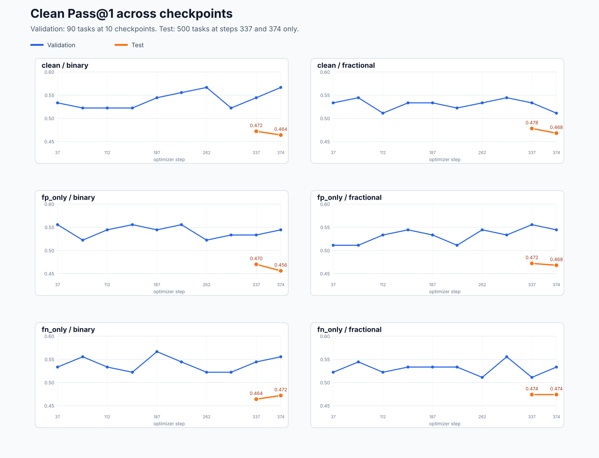
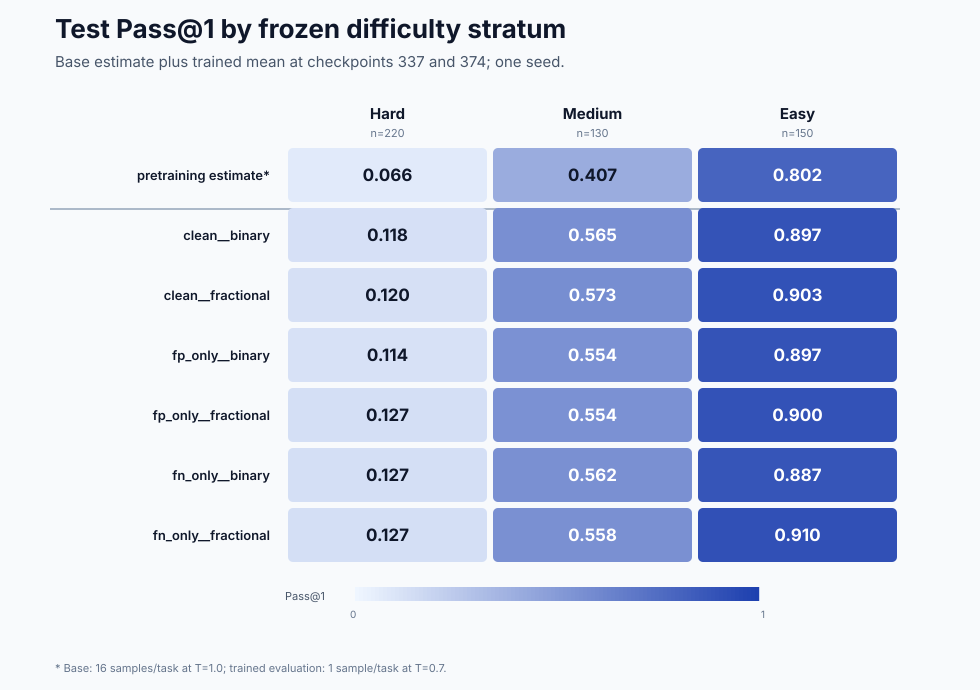
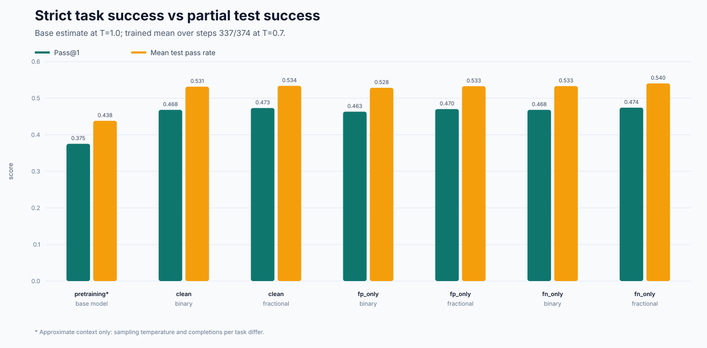

# Evaluation slices — priority_bridge seed 0

> Scope: seed 0 only. The curves are descriptive; they do not quantify variation across training seeds.
> The pretraining row is an approximate context baseline, not an exact matched step-0 evaluation.

## What the metrics mean

- **Clean Pass@1** is the fraction of evaluation problems for which the single generated program passes every clean unit test. It is strict task-level success.
- **Mean test pass rate** is the mean fraction of unit tests passed by the generated programs. It gives partial credit when a program passes some, but not all, tests.
- Validation contains 90 fixed problems, so one problem moves Pass@1 by 1/90 = 1.11 percentage points.
- Test contains 500 fixed problems, so one problem moves Pass@1 by 1/500 = 0.20 percentage points.
- The primary reported metric is the mean clean test Pass@1 over checkpoints 337 and 374. The two checkpoints use the same 500 tasks and are not independent samples.

## Before-training estimate

An exact step-0 validation or test evaluation under the trained-run protocol was not saved. The closest available baseline is the frozen test difficulty map from the same base model revision. It contains 16 sampled completions for each of 500 test tasks, with temperature 1.0. Trained checkpoints were evaluated with one completion per task at temperature 0.7, so the comparison below is approximate rather than controlled.

| Difficulty | Tasks | Completions | Base Pass@1 estimate | Base mean test pass rate |
|---|---:|---:|---:|---:|
| all | 500 | 8000 | 0.375 | 0.438 |
| hard | 220 | 3520 | 0.066 | 0.123 |
| medium | 130 | 2080 | 0.407 | 0.511 |
| easy | 150 | 2400 | 0.802 | 0.837 |

The strata are frozen performance buckets defined by the base model's mean fractional reward: hard ≤ 1/3, medium > 1/3 and < 2/3, easy ≥ 2/3. They describe empirical base-model difficulty, not semantic task types.

## Available checkpoints

- Validation: steps 37, 75, 112, 150, 187, 224, 262, 299, 337, and 374.
- Test: steps 337 and 374 only. A full test learning curve cannot be reconstructed from the saved artifacts.
- Step 0 is shown only for test and only as the approximate multi-sample baseline described above; there is no matching validation step 0.
- Validation predictions are marked with difficulty `unknown`; therefore easy/medium/hard slicing is available for test only. Assigning validation strata now would require a new base-model grading run.

## Condition summary

| Condition | Val 37 | Val 374 | Val range | Test 337 | Test 374 | Test change | Primary test mean |
|---|---:|---:|---:|---:|---:|---:|---:|
| clean__binary | 0.533 | 0.567 | 0.522–0.567 | 0.472 | 0.464 | -0.008 | 0.468 |
| clean__fractional | 0.533 | 0.511 | 0.511–0.544 | 0.478 | 0.468 | -0.010 | 0.473 |
| fp_only__binary | 0.556 | 0.544 | 0.522–0.556 | 0.470 | 0.456 | -0.014 | 0.463 |
| fp_only__fractional | 0.511 | 0.544 | 0.511–0.556 | 0.472 | 0.468 | -0.004 | 0.470 |
| fn_only__binary | 0.533 | 0.556 | 0.522–0.567 | 0.464 | 0.472 | +0.008 | 0.468 |
| fn_only__fractional | 0.522 | 0.533 | 0.511–0.556 | 0.474 | 0.474 | +0.000 | 0.474 |

## Test Pass@1 by difficulty

Each trained value is the mean over test checkpoints 337 and 374.

| Condition | Hard (n=220) | Medium (n=130) | Easy (n=150) |
|---|---:|---:|---:|
| pretraining estimate* | 0.066 | 0.407 | 0.802 |
| clean__binary | 0.118 | 0.565 | 0.897 |
| clean__fractional | 0.120 | 0.573 | 0.903 |
| fp_only__binary | 0.114 | 0.554 | 0.897 |
| fp_only__fractional | 0.127 | 0.554 | 0.900 |
| fn_only__binary | 0.127 | 0.562 | 0.887 |
| fn_only__fractional | 0.127 | 0.558 | 0.910 |

## Figures

## Reading the curves

- Validation curves fluctuate in increments of roughly 0.011 because validation has only 90 tasks. Most visible changes correspond to one to four problems.
- Test changes from step 337 to 374 range from -0.014 to +0.008. This is between seven fewer and four more fully solved tasks out of 500.
- Validation Pass@1 is higher than test Pass@1 at both common checkpoints for every condition. The gap ranges from about 0.037 to 0.103, so validation and test should not be treated as interchangeable scales.
- Overall base Pass@1 is approximately 0.375; trained condition means range from 0.463 to 0.474. The apparent gain is +0.088 to +0.099, subject to the protocol mismatch.
- Hard: base 0.066; trained 0.114–0.127; apparent gain from +0.048 to +0.062.
- Medium: base 0.407; trained 0.554–0.573; apparent gain from +0.147 to +0.166.
- Easy: base 0.802; trained 0.887–0.910; apparent gain from +0.085 to +0.108.
- The largest apparent absolute gain is on medium tasks; hard remains the main bottleneck despite improvement, while easy tasks are already near saturation.
- Mean test pass rate exceeds strict Pass@1 by about 0.06–0.07 in every condition. This is the mass of partially correct programs that pass some tests but fail at least one.
- No condition shows a large, monotone evaluation trend. The saved seed-0 differences are small relative to checkpoint-to-checkpoint validation fluctuation.

## Machine-readable tables

- `evaluation_metrics.csv`: every saved split/checkpoint/difficulty point.
- `evaluation_metric_summary.csv`: one compact row per condition.
- `pretraining_baseline.csv`: the approximate base-model test baseline by difficulty.
